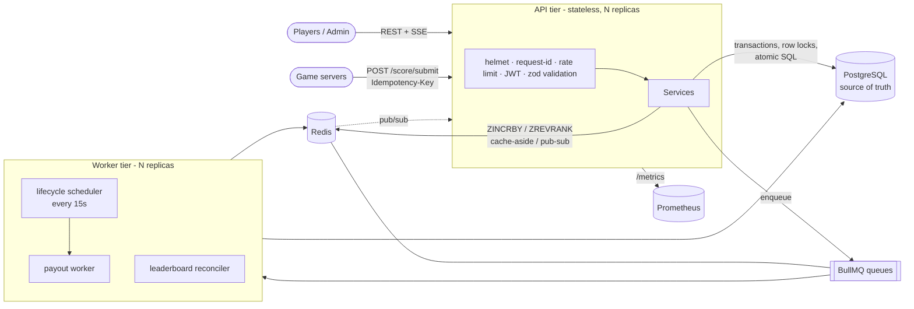

# BlitzRank

A backend for skill-based tournaments: players pay an entry fee from a wallet, game servers report results, and a
**real-time leaderboard** ranks everyone; when a tournament ends, prizes are paid out automatically.

Built to demonstrate production-style backend concerns rather than CRUD: money correctness under concurrency,
idempotency, a Redis-backed real-time read path, background job processing, and observability.

**Stack:** Node.js 22 (ESM) · Express 5 · PostgreSQL 16 (Sequelize) · Redis 7 (ioredis) · BullMQ · Zod · Prometheus · Docker

## Architecture



Two process types share one image: **`api`** (`npm start`) and **`worker`** (`npm run worker`). Both are stateless and
horizontally scalable; all coordination goes through Postgres constraints and Redis.

### Request lifecycle of a score submission (the hot path)

1. `POST /score/submit` → auth (JWT + cached role) → role check → per-caller token bucket → schema validation
2. One Postgres transaction: `INSERT ... ON CONFLICT DO NOTHING` claims the `Idempotency-Key`, then an atomic
   `UPDATE ... SET currentScore = currentScore + $1` applies the score + a history row
3. After commit: `ZINCRBY` on the Redis sorted set, publish on pub/sub (fans out to every API instance's SSE streams),
   enqueue a *debounced* reconcile job
4. Reads (`/leaderboard/...`) are answered from Redis in O(log N); Postgres is only touched to resolve usernames

## Key design decisions

| Problem | Decision | Why |
|---|---|---|
| Double-spend / overdraft under concurrent requests | Balance changes are single atomic `UPDATE ... WHERE balance >= amount RETURNING`, plus a `CHECK (balance >= 0)` constraint | No read-modify-write window; the DB is the last line of defence, not app code |
| Client retries double-counting a result | `Idempotency-Key` header → partial unique index on `ScoreHistories.idempotencyKey` | Race-free even with 25 simultaneous retries; replays return the original result |
| Prize paid twice (job retry, two workers) | Row lock on the tournament + `payoutStatus` flag + partial unique index `(userId, referenceId) WHERE reason='TOURNAMENT_PRIZE'` + deterministic `jobId` | Three independent layers: exactly-once even if any two fail |
| Leaderboard cost grows with players | Redis sorted set per tournament (`ZINCRBY`, `ZREVRANK`, `ZREVRANGE`) | Rank lookup is O(log N) instead of load-all-and-`findIndex` |
| Redis and Postgres can disagree (crash between commit and `ZINCRBY`) | Postgres is the source of truth; debounced BullMQ job rebuilds the ZSET and swaps it in atomically (`RENAME`); cold cache rebuilds lazily | Eventual consistency with a bounded repair window (tested by corrupting Redis) |
| Live updates at scale | Server-Sent Events fed by Redis pub/sub, one shared subscriber per process, throttled to 1 update/s/stream, shared 1s snapshot | Works across replicas; no per-viewer Redis connection |
| Per-process `node-cron` runs N times with N replicas | BullMQ repeatable job scheduler in Redis | Each tick is emitted once cluster-wide; transitions are conditional `UPDATE ... RETURNING` so they're idempotent anyway; a sweep re-enqueues lost payouts |
| Money as floats | Arithmetic in SQL / integer cents (BigInt); `DECIMAL` columns; prize split sums to *exactly* the pool | No cents created or lost (property-tested) |
| Refresh-token theft | Opaque tokens hashed in Redis, rotated on every use, family revoked on re-use | Stolen refresh tokens are detected, access tokens live 15 min |
| Brute force / abuse | Lua token-bucket limiter (atomic across replicas), per IP+username on login; fails open if Redis is down | Availability over strictness for a non-critical control |
| Cache stampede / stale data | Cache-aside with in-process request coalescing, TTL jitter, explicit invalidation on writes; balances are **never** cached | Concurrent misses cost one DB query; money reads are always fresh |
| Duplicate-join race | `INSERT ... ON CONFLICT DO NOTHING` on the unique constraint; exclusive tournament lock taken first (lock ordering avoids share→exclusive deadlocks) | Found & fixed by the concurrency tests |

Also: explicit tournament **state machine** (`OPEN → ACTIVE → COMPLETED`, conditional updates so admin races have one
winner), RBAC with no IDORs, public signup can never mint admins, env validated at boot (no default JWT secret),
uniform error envelope with request ids, structured JSON logs correlated by request id (`AsyncLocalStorage`),
graceful shutdown (drains HTTP + in-flight jobs), `/health` (liveness) and `/ready` (Postgres + Redis) probes.

## Run it

```bash
# Everything (API + worker + Postgres + Redis + Prometheus)
docker compose up --build            # API :3000, Swagger UI :3000/docs, Prometheus :9090

# Or locally (needs Postgres + Redis)
cp .env.example .env                 # set DATABASE_URL / JWT_SECRET
npm ci
npm run db:migrate && npm run db:seed    # seeded users all use password: Passw0rd!123
npm run dev                          # API with workers embedded, auto-reload
# production-style: `npm start` and `npm run worker` as separate processes
ADMIN_USERNAME=me ADMIN_PASSWORD='a-long-password' npm run create-admin
```

Interactive API docs: **`/docs`** (OpenAPI 3, see `openapi.yaml`). Metrics: **`/metrics`** (Prometheus).

## Tests

```bash
npm run test:unit    # pure logic: payout maths, money, state machine (no services needed)
npm test             # + integration tests against real Postgres and Redis (DATABASE_URL / REDIS_URL)
```

45 tests. The integration suite asserts the properties above under real concurrency: 30 parallel debits never
overdraw, 20 parallel joins charge once, 25 parallel retries of one idempotency key apply once, 8 racing payout
workers pay once, Redis drift is repaired from Postgres, and SSE delivers live updates. CI runs both on every push
(`.github/workflows/ci.yml`).

## Performance

`npm run loadtest` (dependency-free). Indicative numbers from a **single Node process on a small shared sandbox
VM, with the load generator, Postgres and Redis on the same machine**, 64 concurrent connections, rate limiting off:

| Scenario | Throughput | p50 | p95 | p99 |
|---|---|---|---|---|
| `GET` player rank (Redis ZSET) | ~2.0k req/s | 29 ms | 52 ms | 78 ms |
| `GET` top 10 | ~1.4k req/s | 47 ms | 56 ms | 63 ms |
| `GET /tournaments` (cache) | ~4.1k req/s | 15 ms | 22 ms | 27 ms |
| `POST /score/submit` (4 hot rows) | ~560 req/s | 112 ms | 145 ms | 180 ms |

After the write run, 3,366 accepted submissions matched the history table exactly and Redis matched Postgres.
Treat these as relative, not absolute, numbers: they will differ on real hardware.

## Project layout

```
src/
  app.js server.js worker.js        # app factory, API entrypoint, worker entrypoint
  config/    env (zod) · db · redis
  routes/ controllers/ validators/  # thin HTTP layer
  services/  wallet · tournament · score · leaderboard · payout · auth   (+ pure *.logic/*.state modules)
  queues/ workers/                  # BullMQ producers / consumers + repeatable lifecycle scheduler
  middlewares/  auth · rbac · validate · rateLimit · metrics · request-id · errors
  lib/       cache · lock · rateLimiter (Lua) · events (pub/sub) · metrics · money
migrations/ seeders/ test/ scripts/ docs/ openapi.yaml Dockerfile docker-compose.yml
```

## Breaking changes from v1

`/users/signup` and `/users/login` moved to `/auth/signup` and `/auth/login` (tokens are now 15-minute access +
rotating refresh tokens); signup no longer accepts a `role`; responses use the `{ error: { code, message } }`
envelope; `GET /leaderboard/:id` is paginated; score submission returns `201` (or `200` on an idempotent replay).
